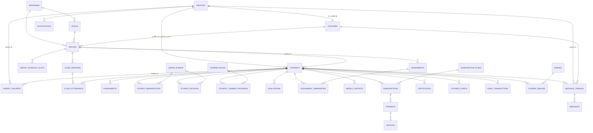

# نموذج البيانات — أكاديمية أُلفة

يرافق هذا الملف الملف التنفيذي [`../supabase/migrations/0001_init_schema.sql`](../supabase/migrations/0001_init_schema.sql). كل جدول هنا موجود فعلياً في تلك الـ migration بنفس الأسماء.

---

## 1. مخطط العلاقات (ERD مبسّط)



---

## 2. الكيانات الأساسية ومعناها

### هوية وأدوار
- **`profiles`** — امتداد لـ `auth.users`. يحمل `role` (super_admin/admin/teacher/parent/student/...). كل مستخدم مسجَّل دخول له صف واحد هنا.
- **`teachers`** — بيانات إضافية خاصة بالمعلم (سيرة، تخصص)، `id` نفسه هو `profiles.id`.

### الطالب والعائلة
- **`students`** — الطفل نفسه. **ليس بالضرورة له حساب دخول** (الأطفال الصغار)؛ `profile_id` يُملأ فقط لليافعين الذين يملكون حساب "طالب".
- **`parent_children`** — جدول ربط: أي وليّ أمر يملك أي طفل (يدعم أكثر من طفل وأكثر من وليّ أمر لنفس الطفل).
- **`assessments`** — التقييم الأولي قبل التسجيل الفعلي (يُنتج `recommended_level_id`).

### طلبات التقييم العامة (قبل التسجيل)
- **`assessment_requests`** *(migration 0002)* — جدول منفصل عمداً عن `assessments`: نموذج "احجز تقييم" في الموقع العام يملأه زائر **لا يملك حساباً بعد**، لذلك لا يمكن ربطه بـ `students`/`parent_children` (تفترضان وليّ أمر موثّق). أي زائر (حتى `anon`) يستطيع الإدراج فقط؛ القراءة والتعديل للإدارة حصراً. تُحوَّل الإدارة الطلب لاحقاً إلى صف `students` + `parent_children` + `assessments` حقيقي عند تسجيل العائلة فعلياً.

### الهيكل الأكاديمي
- **`programs`** → **`levels`** → **`groups`** (الحِلَق) → **`group_schedule_slots`** (الجدول الأسبوعي المتكرر) → **`class_sessions`** (كل حصة فعلية بتاريخ ووقت محددين ورابط اجتماع).

### المتابعة الأكاديمية (قلب المنصة)
- **`class_attendance`** — حضور/غياب لكل طالب في كل حصة.
- **`student_memorization`** — كل مقطع قرآني جديد يُحفظ (سورة + من آية إلى آية + حالة).
- **`student_revision`** — مراجعة (قريبة/قديمة) لتثبيت الحفظ، منفصلة عمداً عن الحفظ الجديد.
- **`student_tajweed_progress`** — مستوى إتقان كل قاعدة تجويد.
- **`evaluations`** — تقييم المعلم لأداء الطالب في حصة معينة (حفظ/تجويد/مراجعة/مشاركة).
- **`assignments` / `assignment_submissions`** — واجبات على مستوى الحلقة، وتتبّع تسليم كل طالب.
- **`weekly_reports`** — **ملخص أسبوعي مُركَّب** يُرسل لولي الأمر (المصدر الوحيد الذي يُعرض في تطبيق الأهل كـ"تقرير").

### القرآن والتجويد (بيانات مرجعية)
- **`quran_surahs`** — قائمة السور (بيانات ثابتة، تُملأ من مصدر موثوق مثل Tanzil/Quran.com قبل الإنتاج — تم إدراج 5 سور فقط كمثال في الـ seed لتفادي إدخال بيانات غير موثقة بالكامل).
- **`tajweed_rules`** — قائمة أحكام التجويد التي تُقيَّم.

### المالية
- **`subscription_plans`** → **`subscriptions`** → **`payments`** → **`invoices`**. العملة والسعر حقول مفتوحة (placeholder) بانتظار قرار العمل (راجع PRD قسم 10).

### التحفيز والشهادات (V2 لكن السكيما جاهزة)
- **`student_points`**, **`point_transactions`**, **`badges`**, **`student_badges`**, **`certificates`**.

### التواصل
- **`notifications`** — إشعارات داخل التطبيق لأي مستخدم.
- **`message_threads` / `messages`** — تواصل مبسّط وليّ أمر ↔ معلم مرتبط بطالب محدد (وليس Chat عام).

---

## 3. لماذا "حفظ جديد" و"مراجعة" جدولان منفصلان؟

لأن أهم ميزة تفريقية للمنصة (حسب رؤية الأكاديمية) هي عرض ثلاثة أبعاد مختلفة لكل طالب في نفس الوقت:
`حفظ جديد` + `مراجعة قريبة` + `مراجعة قديمة`. دمجهما في جدول واحد بحقل "نوع" كان ممكناً، لكن فصلهما يجعل استعلامات لوحة المعلم/التقرير الأسبوعي أبسط ويطابق منطق العمل الفعلي (معدلات جودة مختلفة، ولا علاقة زمنية إلزامية بين الحفظ ومراجعته).

---

## 4. حالة الطالب (`students.enrollment_status`)

الطفل يمر بمراحل قبل أن يصبح "طالباً نشطاً بحلقة"، لذلك `students` تحتوي حالة صريحة بدل استنتاجها من وجود اشتراك:

```
lead → pending_assessment → active → paused / inactive
```

هذا يسمح بإنشاء صف `students` من مرحلة "التسجيل الأولي" (قبل التقييم وقبل تحديد الحلقة)، وهو ما يحتاجه Funnel التسجيل الموصوف في الـ PRD.

---

## 5. سياسات الأمان (Row Level Security)

القاعدة العامة: **لا صف بيانات يخص طفلاً يظهر لأي شخص غير (وليّ أمره المرتبط، معلّم حلقته الحالية، الإدارة)**. التطبيق العملي:

| الدالة المساعدة | الغرض |
|---|---|
| `public.current_role()` | تُرجع دور المستخدم الحالي من `profiles`. |
| `public.is_admin()` | `true` إن كان الدور `admin` أو `super_admin`. |
| `public.is_parent_of(student_id)` | هل `auth.uid()` وليّ أمر مرتبط بهذا الطالب عبر `parent_children`؟ |
| `public.is_teacher_of(student_id)` | هل `auth.uid()` معلّم الحلقة الحالية لهذا الطالب؟ |

كل الجداول الحسّاسة (`students`, `class_attendance`, `student_memorization`, `student_revision`, `evaluations`, `assignment_submissions`, `weekly_reports`, `subscriptions`, `payments`, `certificates`, `messages`...) مفعّل عليها RLS، والسياسات الكاملة موجودة في نص الـ migration مباشرة (قسم `-- RLS POLICIES`) بدل تكرارها هنا حتى لا يحدث تعارض/تقادم بين الوثيقة والكود الفعلي.

---

## 6. مصفوفة الصلاحيات (ملخص وظيفي وليس RLS حرفي)

| الوظيفة | super_admin | admin | teacher | parent | student |
|---|:---:|:---:|:---:|:---:|:---:|
| إدارة المستخدمين وتغيير الأدوار | ✅ | ✅* | ❌ | ❌ | ❌ |
| إدارة البرامج/المستويات/الحلقات | ✅ | ✅ | ❌ | ❌ | ❌ |
| جدولة الحصص | ✅ | ✅ | 👁️ عرض فقط | 👁️ عرض فقط | 👁️ عرض فقط |
| تسجيل الحضور | ✅ | ✅ | ✅ (لحلقاته) | 👁️ | 👁️ |
| تسجيل حفظ/مراجعة/تقييم | ✅ | ✅ | ✅ (لطلابه) | 👁️ | 👁️ |
| إعطاء واجب | ✅ | ✅ | ✅ (لحلقاته) | 👁️ | 👁️ |
| توليد/إرسال التقرير الأسبوعي | ✅ | ✅ | ✅ (لطلابه) | 👁️ (تقارير أبنائه) | 👁️ (تقاريره) |
| إدارة الاشتراكات والمدفوعات | ✅ | ✅ | ❌ | 👁️ + دفع | ❌ |
| رسائل مع طرف آخر | ✅ | ✅ | ✅ (مع أهل طلابه) | ✅ (مع معلمي أبنائه) | ❌ (V1) |
| عرض بيانات طفل غير مرتبط به | ✅ | ✅ | ❌ | ❌ | ❌ |

`✅*` = `admin` لا يستطيع ترقية نفسه أو غيره إلى `super_admin` (محجوزة للتأسيس فقط) — مطبّقة كقيد في سياسة RLS على `profiles.role`.

---

## 7. ملاحظات تنفيذية للـ Backend لاحقاً

- استخدم Supabase Auth لإنشاء `auth.users`، ثم Trigger (`handle_new_user`) لإنشاء صف `profiles` تلقائياً بنفس الـ `id` — موجود في الـ migration.
- `students.profile_id` يُملأ فقط عند تفعيل "حساب طالب" لليافع (13+)، عبر تدفّق منفصل (الإدارة أو وليّ الأمر يدعو الطفل).
- كل الحقول النقدية (`price`, `amount`) من نوع `numeric(10,2)` مع عمود `currency` منفصل — لا نفترض عملة واحدة ثابتة في الكود.
